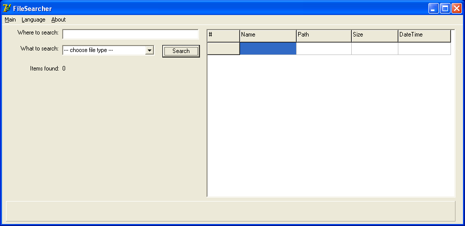

# МИНИСТЕРСТВО ОБРАЗОВАНИЯ РЕСПУБЛИКИ БЕЛАРУСЬ
## Учреждение образования «Белорусский государственный университет информатики и радиоэлектроники»
### Факультет компьютерных систем и сетей
### Кафедра программного обеспечения информационных технологий
### Дисциплина: «Разработка и анализ требований к программному обеспечению»

   

# ОТЧЁТ
## к лабораторной работе № 1
## «ПЛАНИРОВАНИЕ ТЕСТОВЫХ ИСПЫТАНИЙ И АНАЛИЗ ТРЕБОВАНИЙ К ПО»
### Вариант 3 — «File Searcher»

   

<b>Студент гр. 451001</b> 
Забелич Павел Алексеевич (Забелич П. А.)  
<b>Преподаватель:</b> 
Данилова Галина Владимировна (Данилова Г. В.)

   

<b>Минск, 2026</b>

---

## СОДЕРЖАНИЕ

1. [Цель работы и исходные данные](#цель-работы-и-исходные-данные)
2. [Исходные требования к проекту (Вариант № 3)](#исходные-требования-к-проекту-вариант--3)
3. [Раздел 1. Анализ требований и выявление дефектов](#раздел-1-анализ-требований-и-выявление-дефектов)
   - 1.1. [Критерии качества требований (ISO/IEC/IEEE 29148 и С. Куликов)](#11-критерии-качества-требований-isoiecieee-29148-и-с-куликов)
   - 1.2. [Построчный критический анализ спецификации](#12-построчный-критический-анализ-спецификации)
   - 1.3. [Сводный реестр выявленных дефектов требований](#13-сводный-реестр-выявленных-дефектов-требований)
   - 1.4. [Формулирование вопросов к заказчику (Requirements Clarification)](#14-формулирование-вопросов-к-заказчику-requirements-clarification)
4. [Раздел 2. Учебный тест-план проекта «File Searcher»](#раздел-2-учебный-тест-план-проекта-file-searcher)
   - 2.1. [Суть и основные цели проекта](#21-суть-и-основные-цели-проекта)
   - 2.2. [Требования, подвергаемые тестированию (In Scope)](#22-требования-подвергаемые-тестированию-in-scope)
   - 2.3. [Требования, не подвергаемые тестированию (Out of Scope)](#23-требования-не-подвергаемые-тестированию-out-of-scope)
   - 2.4. [Тестовая стратегия](#24-тестовая-стратегия)
   - 2.5. [Критерии качества](#25-критерии-качества)
   - 2.6. [Ресурсы (программные, аппаратные, временные)](#26-ресурсы)
   - 2.7. [Расписание](#27-расписание)
   - 2.8. [Роли и ответственность](#28-роли-и-ответственность)
   - 2.9. [Оценка рисков](#29-оценка-рисков)
   - 2.10. [Документация](#210-документация)
   - 2.11. [Метрики](#211-метрики)
5. [Заключение](#заключение)
6. [Список использованных источников](#список-использованных-источников)

---

## ЦЕЛЬ РАБОТЫ И ИСХОДНЫЕ ДАННЫЕ

**Цель работы:**
1. Освоение практических навыков анализа, верификации и валидации спецификаций требований к программному обеспечению на ранних этапах жизненного цикла.
2. Выявление, формализация и классификация дефектов требований в соответствии с отраслевыми стандартами (ISO/IEC/IEEE 29148:2018, IEEE 830) и рекомендациями профессиональной литературы (С. Святослав Куликов «Тестирование программного обеспечения. Базовый курс»).
3. Составление структурированного опросного листа (вопросов к заказчику) для устранения выявленных неопределенностей, противоречий, технологических пробелов и невыполнимых условий.
4. Разработка комплексного учебного тест-плана (Test Plan) программного проекта по стандартной структуре раздела 2.6 книги С. Куликова, определяющего цели, объем, стратегию, критерии качества, ресурсы, график, матрицу рисков и метрики контроля качества.

**Исходные материалы:**
- Методические указания к лабораторной работе № 1 «Планирование тестовых испытаний» (БГУИР);
- Спецификация требований к учебному проекту «File Searcher» (Вариант № 3);
- Макет графического интерфейса пользователя (Скриншот 1).

---

## ИСХОДНЫЕ ТРЕБОВАНИЯ К ПРОЕКТУ (ВАРИАНТ № 3)

> **БГУИР, ТВОП / РиАТПО, требования к проекту (Вариант 3):**  
> *«Проанализируйте набор требований, найдите и классифицируйте дефекты, задайте вопросы заказчику. Подумайте о том, как наилучшим образом оформить вашу работу. И сделайте это :)»*

### Текст исходных требований:
1. **Общее описание:** Приложение «File Searcher» (далее FS) предназначено для автоматического поиска файлов по заданному шаблону.
2. **Платформа реализации:** Приложение должно быть написано на Delphi 7 и работать под Win XP и Win 7.
3. **Область поиска:** Для поиска указывается начальный каталог или набор каталогов. FS автоматически сканирует каталоги на неограниченную глубину вложенности и отображает все найденные файлы в правой панели (см. скриншот 1).
4. **Фильтрация типов:** Для поиска доступно три типа файлов (выбор производит вручную или с помощью комбо-бокса «Что искать»):
   - Аудиофайлы (mp3, ogg, wav, mid).
   - Видеофайлы (avi, mpg, mpeg).
   - Офисные файлы (doc, docx, xls, xlsx).
5. **Отображаемые атрибуты:** По всем найденным файлам отображается:
   - Имя.
   - Полный путь.
   - Размер.
   - Дата-время создания файла.
   - Скриншот с первым кадром.
6. **Производительность:**
   - FS должно искать не менее 500 файлов в секунду при условии, что скорость чтения/записи на диск превышает 50 Мб в секунду.
   - В случае, если общее время операции превышает 1 час, приложение не должно начинать работу.
7. **Поддержка языков:**
   - Приложение должно поддерживать русский и английский языки по умолчанию.
   - Должна быть возможность добавлять новые языки.
8. **Логирование:**
   - FRS должно вести лог своей работы.
   - Если размер лога превышает 1 Мб, ведение лога прекращается.
   - Текущий анализируемый каталог должен отображаться в панели «Сейчас проверяется» внизу экрана.
9. **Поддержка файловых систем:**
   - Должны поддерживаться все файловые системы Windows и UNIX.
   - В случае обнаружения неподдерживаемой FS, FS должно аварийно завершать работу.
10. **Сетевые возможности:** Должна быть поддержка сети.

### Макет графического интерфейса (Скриншот 1):

---

## РАЗДЕЛ 1. АНАЛИЗ ТРЕБОВАНИЙ И ВЫЯВЛЕНИЕ ДЕФЕКТОВ

### 1.1. Критерии качества требований (ISO/IEC/IEEE 29148 и С. Куликов)

Качественные требования к программному обеспечению являются базисом успешной разработки и эффективного тестирования. В соответствии со стандартом **ISO/IEC/IEEE 29148:2018** (*Systems and software engineering — Life cycle processes — Requirements engineering*), а также классификацией, изложенной в базовом курсе С. Святослава Куликова («Тестирование программного обеспечения. Базовый курс»), каждое требование должно удовлетворять следующим фундаментальным характеристикам:

1. **Недвусмысленность / Однозначность (Unambiguous):** Требование допускает только одну-единственную интерпретацию всеми участниками проекта (заказчик, аналитик, разработчик, тестировщик). Формулировки исключают субъективные наречия («быстро», «удобно», «достаточно»).
2. **Полнота (Complete):** Требование содержит всю необходимую информацию для реализации и тестирования, определяет поведение системы как в штатных условиях, так и в исключительных ситуациях (обработка ошибок, граничные условия).
3. **Непротиворечивость (Consistent):** Требование не противоречит другим требованиям спецификации, действующим стандартам, законам физики и логики, а также графическим макетам (GUI).
4. **Проверяемость / Тестируемость (Verifiable / Testable):** Существует конечный, рентабельный и объективный процесс проверки того, удовлетворяет ли система данному требованию.
5. **Выполнимость / Реализуемость (Feasible):** Требование может быть технически реализовано в рамках заданных технологических ограничений, архитектуры, бюджета и сроков проекта.
6. **Атомарность / Неделимость (Atomic):** Требование описывает единичную неделимую функцию или ограничение, не объединяя разнородные логические блоки в одно предложение.
7. **Модифицируемость (Modifiable):** Структура требований и стиль изложения позволяют легко вносить изменения без потери целостности спецификации.
8. **Трассируемость (Traceable):** Каждое требование имеет уникальный идентификатор и может быть прослежено до бизнес-целей, архитектурных модулей и тест-кейсов.
9. **Корректность (Correct):** Требование верно описывает реальные потребности пользователей и предметную область.
10. **Обязательность и приоритет (Ranked for Importance / Stability):** Требование имеет явный приоритет (например, по шкале MoSCoW: Must have, Should have, Could have, Won\'t have).

---

### 1.2. Построчный критический анализ спецификации

Ниже приведен детальный технический анализ каждого пункта исходной спецификации требований варианта № 3.

#### Требование 1: «Приложение «File Searcher» (далее FS) предназначено для автоматического поиска файлов по заданному шаблону.»
- **Проблема неполноты и двусмысленности:** Понятие «шаблон» (pattern / mask) не специфицировано. В разработке ПО под шаблоном может пониматься:
  1. Маска имени файла со специальными символами (`*`, `?`);
  2. Регулярные выражения (RegEx: POSIX, PCRE);
  3. Полнотекстовый поиск по содержимому документов (Full-text content search);
  4. Поиск по диапазону дат или размеров.
- **Влияние на тестирование:** Невозможно составить позитивные и негативные тест-кейсы на сопоставление с шаблоном без формализованного синтаксиса.

#### Требование 2: «Приложение должно быть написано на Delphi 7 и работать под Win XP и Win 7.»
- **Архитектурные и технологические дефекты:**
  1. *Юникод и интернационализация:* Delphi 7 (выпущена в 2002 г.) использует 1-байтовую ANSI-строковую модель (`AnsiString`). Под Windows XP и Windows 7 файловая система NTFS нативно хранит имена файлов в кодировке UTF-16 (Unicode). При обработке файлов с именами на китайском, арабском или европейских языках со спецсимволами стандартные функции Delphi 7 (`FindFirst`, `FindNext`, `TFileListBox`) необратимо искажают имена (заменяя не-ANSI символы на знак `?`).
  2. *Разграничение прав (UAC) и виртуализация:* В Windows 7 внедрен контроль учетных записей (UAC). Попытка сканирования системных каталогов (`C:\Program Files`, `C:\Windows`, `C:\System Volume Information`) без прав администратора вызовет исключение `EInOutError` или `Win32 Error 5: Access is Denied`. В требованиях отсутствует описание обработки отказа в доступе.
  3. *Разрядность платформ:* Не указано, поддерживаются ли 64-битные редакции Windows 7 (x64) с подсистемой WOW64 и перенаправлением системных папок (`SysWOW64` vs `System32`).

#### Требование 3: «Для поиска указывается начальный каталог или набор каталогов. FS автоматически сканирует каталоги на неограниченную глубину вложенности и отображает все найденные файлы в правой панели (см. скриншот 1).»
- **Логическая и техническая невыполнимость:**
  1. *Неограниченная глубина:* В Win32 API действует ограничение `MAX_PATH = 260` символов (для преодоления требуется префикс `\\?\`, поддержка которого в стандартном RTL Delphi 7 отсутствует). Кроме того, рекурсивный обход на «неограниченную» глубину неизбежно приведет к переполнению стека вызовов (`Stack Overflow Exception`).
  2. *Циклические ссылки:* В NTFS поддерживаются точки соединения (Directory Junctions) и символические ссылки (Symlinks). При рекурсивном сканировании ссылка может указывать на родительский каталог, что вызовет бесконечный цикл (infinite loop) и зависание приложения при отсутствии детектора циклов.
  3. *Противоречие между текстом и UI (Скриншот 1):*
     - Текст требует: «указывается начальный каталог или набор каталогов».
     - В UI представлено однострочное текстовое поле `Where to search:`. Отсутствует кнопка обзора («Browse...»), отсутствует диалог множественного выбора папок. Не определен разделитель для набора каталогов (точка с запятой `;`, запятая `,`, пробел?).

#### Требование 4: «Для поиска доступно три типа файлов (выбор производит вручную или с помощью комбо-бокса «Что искать»): Аудиофайлы (mp3, ogg, wav, mid). Видеофайлы (avi, mpg, mpeg). Офисные файлы (doc, docx, xls, xlsx).»
- **Грамматические ошибки и противоречия с UI:**
  1. *Грамматический дефект:* Опечатка «выбор производит вручную» (вместо «производится»).
  2. *Противоречие интерфейса:* На скриншоте комбо-бокс `What to search:` имеет плейсхолдер `--- choose file type ---`. Поле ввода для ручного указания маски отсутствует. Что значит «выбор вручную»? Ввод произвольного расширения пользователем в выпадающий список? Если стиль комбо-бокса `csDropDownList`, ручной ввод заблокирован.
  3. *Неполнота:* Список расширений жестко ограничен и устарел:
     - Аудио: отсутствуют популярные форматы `flac`, `aac`, `m4a`, `wma`.
     - Видео: отсутствуют `mp4`, `mkv`, `mov`, `wmv`.
     - Офисные: отсутствуют форматы презентаций `ppt`, `pptx`, открытые форматы `odt`, `ods`, а также `pdf` и обычные текстовые файлы `txt`.
     - Отсутствует возможность поиска по всем типам файлов одновременно (`*.*`).

#### Требование 5: «По всем найденным файлам отображается: Имя. Полный путь. Размер. Дата-время создания файла. Скриншот с первым кадром.»
- **Критическое противоречие с макетом и абсурдность бизнес-логики:**
  1. *Противоречие с UI:* На Скриншоте 1 таблица содержит только 5 столбцов: `#` (порядковый номер), `Name` (имя), `Path` (путь), `Size` (размер), `DateTime` (дата и время). **Колонка со скриншотом/кадром в интерфейсе отсутствует!**
  2. *Физическая и логическая невыполнимость:* Требование гласит: «По **всем** найденным файлам отображается скриншот с первым кадром». Однако:
     - Аудиофайлы (mp3, wav, ogg, mid) **не имеют видеопотока и видеокадров** в принципе!
     - Офисные файлы (doc, docx, xls, xlsx) состоят из страниц/таблиц, а не видеокадров.
     - Для извлечения первого кадра видео (avi, mpg, mpeg) на Delphi 7 требуются сторонние тяжелые библиотеки и видеокодеки (DirectShow / VFW / FFmpeg). В случае отсутствия кодека в системе Win XP/7 приложение упадет.
  3. *Неоднозначность временной метки:* В требованиях указано «Дата-время создания файла» (Creation Time). Однако в NTFS/FAT существуют также дата последней модификации (Last Write Time) и дата последнего доступа (Last Access Time). На скриншоте колонка называется `DateTime`. В подавляющем большинстве файловых менеджеров пользователи ориентируются на дату модификации файла, а не дату создания (которая часто меняется при копировании).
  4. *Форматирование размера:* Не указано, в каких единицах отображается размер (байты, КБ, МБ или авто-масштабирование B/KB/MB/GB).

#### Требование 6: «Производительность. FS должно искать не менее 500 файлов в секунду при условии, что скорость чтения/записи на диск превышает 50 Мб в секунду. В случае, если общее время операции превышает 1 час, приложение не должно начинать работу.»
- **Логический парадокс и некорректные метрики:**
  1. *Парадокс остановки (Проблема останова Тьюринга):* Требование «В случае, если общее время операции превышает 1 час, приложение не должно начинать работу» является **алгоритмически неразрешимым**. Программа не может вычислить точное время сканирования ДО начала сканирования, поскольку ей неизвестны: количество файлов на диске, глубина дерева каталогов, размер каталогов, степень фрагментации MFT, скорость вращения шпинделя HDD, текущая фоновая загрузка диска другими процессами и сетью.
  2. *Некорректная зависимость производительности:* Поиск файлов — это операция обхода метаданных файловой системы (чтение каталожных дескрипторов и записей $MFT), которая упирается в **случайный доступ (IOPS)** и латентность диска, а не в линейную скорость потокового чтения/записи больших файлов (МБ/с). На стандартном жестком диске (HDD 5400/7200 RPM) времен Win XP скорость случайного чтения мелких блоков составляет 0.5–2 МБ/с (70–120 IOPS), что делает условие «скорость > 50 МБ/с» недостижимым при обычном поиске файлов на HDD без кэширования.

#### Требование 7: «Поддержка языков. Приложение должно поддерживать русский и английский языки по умолчанию. Должна быть возможность добавлять новые языки.»
- **Противоречие и неполнота архитектуры локализации:**
  1. *Противоречие со скриншотом:* На макете Скриншота 1 все надписи строго на английском языке (`Main`, `Language`, `About`, `Where to search:`, `What to search:`, `Search`, `Items found: 0`).
  2. *Неопределенность поведения «по умолчанию»:* Приложение не может одновременно отображать два языка по умолчанию. Должен быть критерий выбора: определение локали операционной системы (`GetSystemDefaultLCID`) либо фиксация английского при первом запуске.
  3. *Неполнота механизма расширения:* Не описан механизм добавления новых языков (внешние текстовые файлы `.ini`, `.lng`, `.po` или компилируемые ресурсы / DLL).

#### Требование 8: «Логирование. FRS должно вести лог своей работы. Если размер лога превышает 1 Мб, ведение лога прекращается. Текущий анализируемый каталог должен отображаться в панели «Сейчас проверяется» внизу экрана.»
- **Дефекты надежности и терминологии:**
  1. *Несогласованность терминологии (опечатка):* Появляется новая аббревиатура **FRS** вместо **FS** (File Searcher).
  2. *Критический дефект архитектуры логирования:* Прекращение записи лога при достижении 1 Мб приводит к потере диагностической информации как раз в моменты длительных, объемных и потенциально проблемных сканирований. Стандартным решением в индустрии является **ротация логов** (log rotation: архивация, перезапись по кругу либо создание файлов `app.log.1`, `app.log.2`).
  3. *Неполнота спецификации лога:* Не указан формат лога, путь сохранения файла, уровень детализации (INFO, WARNING, ERROR, DEBUG).
  4. *Несоответствие интерфейсу:* На Скриншоте 1 нижняя панель пуста, текст «Сейчас проверяется» отсутствует.

#### Требование 9: «Поддержка файловых систем: Должны поддерживаться все файловые системы Windows и UNIX. В случае обнаружения неподдерживаемой FS, FS должно аварийно завершать работу.»
- **Грубейшие дефекты архитектуры и надежности:**
  1. *Архитектурная невыполнимость:* ОС Windows XP и Windows 7 поддерживают файловые системы FAT12, FAT16, FAT32, NTFS, exFAT, CDFS, UDF. Файловые системы UNIX (ext2, ext3, ext4, XFS, Btrfs, UFS, ZFS) не поддерживаются Windows нативно. Для их поддержки потребовалась бы интеграция специализированных низкоуровневых драйверов ядра Windows, что выходит далеко за рамки пользовательского приложения на Delphi 7.
  2. *Нарушение базовых принципов надежности (Crash by Design):* Требование «аварийно завершать работу» (Crash / Terminate Process) при обнаружении неподдерживаемой ФС является критическим дефектом спецификации. Аварийное падение программы ведет к потере несохраненных результатов поиска, повреждению файла лога и резкому негативному пользовательскому опыту. Приложение обязано выполнить контролируемую обработку исключительной ситуации: вывести информационное предупреждение пользователю и пропустить недоступный том/каталог.

#### Требование 10: «Должна быть поддержка сети.»
- **Абсолютная неполнота и абстрактность:**
  Требование состоит из одной общей фразы. Не специфицировано:
  - Имеется ли в виду доступ к общим сетевым папкам Windows через протоколы SMB/CIFS (UNC-пути вида `\\server\share`)?
  - Поиск файлов на сетевых хранилищах (NAS)?
  - Поиск по протоколам FTP, FTPS, SFTP, WebDAV?
  - Сетевая архитектура клиент-сервер с удаленным агентом?
  - Поведение при разрыве сетевого соединения во время сканирования.

---

### 1.3. Сводный реестр выявленных дефектов требований

Ниже приведена итоговая сводная матрица выявленных дефектов спецификации требований с классификацией по стандарту ISO/IEC/IEEE 29148 и градации серьезности (Severity):
- **Critical (Блокирующий / Критический):** Дефект делает невозможной реализацию или эксплуатацию системы, содержит логический парадокс либо проектирует аварийное падение (Crash by Design).
- **Major (Высокий / Значительный):** Существенное противоречие с макетом интерфейса или техническими ограничениями ОС, приводящее к срыву функционала.
- **Medium (Средний):** Неполнота описания, отсутствие спецификации формата или обработки краевых случаев.
- **Minor (Низкий / Косметический):** Опечатки, несогласованность аббревиатур.

| ID дефекта | Фрагмент требования | Нарушенный критерий качества | Описание дефекта | Критичность | Рекомендация по устранению |
|:---:|:---|:---|:---|:---:|:---|
| **DEF-01** | «В случае, если общее время операции превышает 1 час, приложение не должно начинать работу.» | Выполнимость, Проверяемость, Корректность | **Логический парадокс остановки (Halting problem):** невозможно заранее вычислить точное время поиска без сканирования диска. | **Critical** | Заменить требование на возможность установки пользователем тайм-аута операции или ручной отмены (кнопка «Stop/Cancel»), либо вывод предупреждения при сканировании томов более заданного объема. |
| **DEF-02** | «В случае обнаружения неподдерживаемой FS, FS должно аварийно завершать работу.» | Корректность, Надежность (ISO 25010) | **Crash by Design:** аварийное падение процесса является грубым нарушением стандартов надежности, ведет к потере данных и порче логов. | **Critical** | Заменить аварийное завершение на перехват исключения, отображение предупреждения пользователю и безопасный пропуск неподдерживаемого раздела. |
| **DEF-03** | «FS автоматически сканирует каталоги на неограниченную глубину вложенности» | Выполнимость, Полнота | Ограничение Win32 `MAX_PATH = 260`, риск стекового переполнения и бесконечного зацикливания на NTFS Junction Points / Symlinks. | **Major** | Ограничить максимальную глубину (например, 64 уровня), добавить детектор циклических ссылок и обработку длинных путей через префикс `\\?\`. |
| **DEF-04** | «Должны поддерживаться все файловые системы Windows и UNIX.» | Выполнимость, Корректность | Windows XP / 7 не поддерживают файловые системы UNIX нативно. Delphi 7 работает через Win32 API и не может обращаться к raw ext4/XFS без спецдрайверов. | **Major** | Уточнить поддержку: ограничить локальными ФС Windows (NTFS, FAT32, exFAT) и удаленными сетевыми ресурсами (SMB/CIFS), монтируемыми средствами ОС. |
| **DEF-05** | «По всем найденным файлам отображается: ... Скриншот с первым кадром.» | Непротиворечивость, Выполнимость, Полнота | 1. На Скриншоте 1 нет колонки под превью. 2. Аудиофайлы и офисные документы не имеют кадров. 3. Извлечение кадров требует видеокодеков. | **Major** | 1. Привести в соответствие с UI: удалить колонку кадра или добавить в UI область предварительного просмотра (Preview Panel). 2. Отображать превью первого кадра только для видеофайлов при наличии системных кодеков. |
| **DEF-06** | «Для поиска указывается начальный каталог или набор каталогов... (см. скриншот 1)» | Непротиворечивость, Полнота | На скриншоте 1 однострочное поле ввода, кнопки «Обзор» нет, разделитель для нескольких папок не задан. | **Major** | Добавить кнопку «Browse...» (выбор каталога через диалог), специфицировать разделитель (точка с запятой `;`), предусмотреть многострочный список папок. |
| **DEF-07** | «Должна быть поддержка сети.» | Полнота, Проверяемость | Полная абстрактность. Не указаны протоколы, способы авторизации, типы сетевых путей. | **Major** | Уточнить: «Поддержка сканирования общедоступных сетевых каталогов Windows по протоколу SMB/CIFS с использованием UNC-путей вида `\\server\share`». |
| **DEF-08** | «FS должно искать не менее 500 файлов в секунду при условии, что скорость чтения/записи на диск превышает 50 Мб в секунду.» | Проверяемость, Корректность | Поиск файлов упирается в случайный доступ (IOPS) к $MFT, а не в линейную пропускную способность потокового чтения/записи (МБ/с). | **Major** | Сформулировать требование на основе IOPS или зафиксировать тестовый бенчмарк (например, поиск в каталоге из 50 000 файлов на эталонном стенде за время не более N секунд). |
| **DEF-09** | «FRS должно вести лог своей работы. Если размер лога превышает 1 Мб, ведение лога прекращается.» | Корректность, Надежность, Полнота | Прекращение логирования при 1 Мб оставляет систему без отладки. Отсутствует путь к файлу лога и уровень детализации. | **Medium** | Внедрить кольцевую ротацию логов: при достижении 1 Мб текущий лог переименовывается в `fs.log.old`, создается новый файл. Определить путь: `%APPDATA%\FileSearcher\fs.log`. |
| **DEF-10** | «Текущий анализируемый каталог должен отображаться в панели «Сейчас проверяется» внизу экрана.» | Непротиворечивость | На макете Скриншота 1 нижняя панель пустая, текст отсутствует. | **Medium** | Привести GUI к соответствию: разместить в StatusBar метку «Сейчас проверяется: [Путь]» с автоматическим сокращением длинных путей (ellipses: `C:\...\folder`). |
| **DEF-11** | «выбор производит вручную или с помощью комбо-бокса «Что искать»» | Непротиворечивость, Полнота | 1. На скриншоте нет поля ручного ввода. 2. Опечатка («производит» вместо «производится»). 3. Нельзя ввести пользовательскую маску (`*.txt`). | **Medium** | Добавить поле ручного ввода маски поиска (или разрешить редактирование в ComboBox со стилем `csDropDown`). Исправить опечатку. |
| **DEF-12** | «Приложение должно поддерживать русский и английский языки по умолчанию. Должна быть возможность добавлять новые языки.» | Непротиворечивость, Полнота | На скриншоте весь интерфейс на английском. Не описан механизм добавления языков и алгоритм выбора языка по умолчанию. | **Medium** | Описать механизм локализации (внешние `.ini`/`.lng` файлы в папке `Languages/`). Выбор по умолчанию осуществлять на основе системной локали Windows. |
| **DEF-13** | «Дата-время создания файла» | Непротиворечивость, Полнота | На скриншоте колонка называется `DateTime`. В файловой системе есть Creation, Last Write, Last Access. | **Low** | Уточнить: отображать дату последней модификации (Last Modified), как наиболее ценную для пользователя, либо дать возможность выбора отображаемой даты. |
| **DEF-14** | «FRS должно вести лог своей работы.» | Непротиворечивость | Опечатка в наименовании: используется аббревиатура **FRS** вместо **FS**. | **Minor** | Заменить «FRS» на «FS» по всему тексту спецификации. |

---

### 1.4. Формулирование вопросов к заказчику (Requirements Clarification)

На основе выявленных дефектов сформирован структурированный опросный лист (Clarification Request), направляемый заказчику для согласования изменений в спецификации:

#### Блок 1. Бизнес-логика и производительность
1. **Вопрос по условию отмены поиска при превышении 1 часа (DEF-01):**  
   *Контекст:* До начала сканирования технически невозможно точно рассчитать общее время работы, так как структура каталогов и нагрузка на накопитель неизвестны.  
   *Предложение:* Согласны ли вы заменить это условие на добавление кнопки «Остановить поиск» (Cancel) в интерфейс и опционального поля «Максимальное время поиска (тайм-аут)» в настройках?
2. **Вопрос по метрикам производительности (DEF-08):**  
   *Контекст:* Линейная скорость чтения диска в МБ/с не характеризует скорость обхода каталогов файловой системы (IOPS).  
   *Предложение:* Предлагаем зафиксировать требование в виде: «На эталонном стенде (Windows 7 x64, Intel Core i3, HDD 7200 RPM) скорость сканирования структуры каталогов NTFS должна составлять не менее 500 записей файлов в секунду при глубине вложенности до 10 уровней». Согласны ли вы с такой формулировкой?

#### Блок 2. Пользовательский интерфейс (UI/UX)
3. **Вопрос по скриншоту первого кадра (DEF-05):**  
   *Контекст:* На Скриншоте 1 отсутствует колонка или область превью первого кадра. Кроме того, у аудиофайлов и офисных документов кадры отсутствуют физически.  
   *Предложение:* Исключить отображение кадра из общей таблицы результатов. При необходимости реализовать отдельную сворачиваемую панель «Предварительный просмотр» (Preview Panel), в которой первый кадр генерируется исключительно при выделении видеофайлов (avi, mpg, mpeg).
4. **Вопрос по указанию каталогов поиска (DEF-06):**  
   *Контекст:* На скриншоте представлено однострочное поле без кнопки обзора.  
   *Предложение:* Добавить кнопку «Обзор...» для открытия системного диалога выбора папки, а также зафиксировать символ точку с запятой (`;`) в качестве официального разделителя для перечисления нескольких каталогов в поле ввода.
5. **Вопрос по ручному вводу типов файлов (DEF-11):**  
   *Контекст:* В комбо-боксе представлены только 3 фиксированные группы расширений. Пользователю может потребоваться поиск файлов `.pdf`, `.txt` или по произвольной маске.  
   *Предложение:* Добавить в ComboBox пункт «Пользовательская маска...» и разблокировать поле для ручного ввода масок (например, `*.txt; *.pdf; report*.*`).

#### Блок 3. Платформа, файловые системы и надежность
6. **Вопрос по поддержке файловых систем UNIX (DEF-04):**  
   *Контекст:* ОС Windows XP и Windows 7 не поддерживают нативно файловые системы ext2/3/4, UFS, XFS.  
   *Предложение:* Ограничить объем поддержки локальными ФС семейства Windows (NTFS, FAT16, FAT32, exFAT), а также сетевыми ресурсами SMB/CIFS. Согласны ли вы?
7. **Вопрос по аварийному завершению работы (DEF-02):**  
   *Контекст:* Аварийное падение (Crash) при встрече неподдерживаемой ФС или недоступной папки недопустимо для надежного ПО.  
   *Предложение:* При обнаружении неподдерживаемой ФС или ошибке доступа (`Access Denied`) выводить диалоговое окно с предупреждением, записывать событие в лог и продолжать сканирование доступных областей.
8. **Вопрос по сетевой поддержке (DEF-07):**  
   *Контекст:* Требование «Должна быть поддержка сети» не конкретизировано.  
   *Предложение:* Ограничить сетевую поддержку возможностью указывать стандартные сетевые UNC-пути Windows (например, `\\ServerName\SharedFolder`).

#### Блок 4. Логирование и локализация
9. **Вопрос по механизму ограничения размера лога (DEF-09):**  
   *Контекст:* Прекращение записи лога при 1 Мб лишает службу поддержки информации о сбоях в конце длительной работы.  
   *Предложение:* Использовать кольцевую ротацию: при достижении 1 Мб файл `app.log` переименовывается в `app.log.1`, а запись продолжается в новый чистый `app.log`.
10. **Вопрос по добавлению новых языков (DEF-12):**  
    *Контекст:* Не указан формат файлов локализации.  
    *Предложение:* Использовать стандартные текстовые INI-файлы в каталоге `/Languages` (например, `Russian.ini`, `English.ini`, `German.ini`), считываемые приложением динамически при запуске и заполнении меню «Language».

---

## РАЗДЕЛ 2. УЧЕБНЫЙ ТЕСТ-ПЛАН ПРОЕКТА «FILE SEARCHER»

Настоящий тест-план разработан в соответствии со структурой, рекомендованной в разделе 2.6 книги С. Святослава Куликова («Оценка трудозатрат, планирование и отчётность»), и базируется на результатах предварительного анализа требований варианта № 3.

---

### 2.1. Суть и основные цели проекта

**Наименование проекта:** File Searcher (FS).  
**Назначение продукта:** Десктопное приложение для операционных систем семейства Windows, предназначенное для быстрого автоматизированного поиска файлов заданных категорий (аудио, видео, документы) и произвольных масок в указанных локальных каталогах и сетевых общих ресурсах с отображением подробных метаданных (имя, путь, размер, дата-время) и возможностью экспорта/сохранения истории в лог-файл.

**Цели тестирования:**
1. Верификация корректности реализации поисковых алгоритмов и механизмов фильтрации файлов по расширениям.
2. Подтверждение стабильности и отказоустойчивости приложения при работе с файловыми структурами различной глубины вложенности и объемами данных.
3. Проверка соответствия графического интерфейса пользователя требованиям эргономики и макету.
4. Оценка показателей быстродействия (числа обрабатываемых файлов в секунду) на целевых конфигурациях ОС (Windows XP, Windows 7).
5. Предотвращение регрессионных дефектов и обеспечение высокого качества релизной версии перед передачей заказчику.

---

### 2.2. Требования, подвергаемые тестированию (In Scope)

В область тестирования (Scope In) включаются функции, которые специфицированы корректно и реализуемы в рамках архитектуры Win32/Delphi 7:

1. **Функциональность графического интерфейса (GUI):**
   - Корректность отрисовки элементов главного окна: меню (`Main`, `Language`, `About`), поле ввода каталогов (`Where to search:`), выпадающий список типов (`What to search:`), кнопка запуска (`Search`), счетчик найденных элементов (`Items found: N`), таблица результатов, строка состояния (`StatusBar`).
   - Реакция элементов управления на действия пользователя (фокус, клик, нажатие клавиши Enter).
   - Динамическое обновление счетчика `Items found` в реальном времени при нахождении файлов.
2. **Указание и валидация каталогов поиска:**
   - Поиск в одиночном локальном каталоге (например, `C:\Music`).
   - Поиск в наборе каталогов, разделенных точкой с запятой (например, `C:\Docs; D:\Archive`).
   - Поиск в корневом каталоге логического диска (`C:\`, `D:\`).
   - Обработка некорректных путей (несуществующая папка, опечатка в пути, недопустимые символы в имени каталога: `*`, `?`, `"`, `<`, `>`, `|`).
3. **Фильтрация по категориям файлов (расширениям):**
   - Группа «Аудиофайлы»: фильтрация файлов с расширениями `.mp3`, `.ogg`, `.wav`, `.mid`.
   - Группа «Видеофайлы»: фильтрация файлов с расширениями `.avi`, `.mpg`, `.mpeg`.
   - Группа «Офисные файлы»: фильтрация файлов с расширениями `.doc`, `.docx`, `.xls`, `.xlsx`.
   - Регистронезависимость поиска расширений (корректное нахождение `.MP3`, `.Mp3`, `.mp3`).
4. **Отображение метаданных найденных файлов в таблице:**
   - Порядковый номер строки (`#`).
   - Имя файла с расширением (`Name`).
   - Полный абсолютный путь к каталогу размещения файла (`Path`).
   - Размер файла с форматированием (`Size`).
   - Дата и время файла (`DateTime`).
   - Сортировка строк таблицы по клику на заголовки столбцов.
5. **Индикация процесса сканирования:**
   - Отображение текущего сканируемого каталога в нижней панели состояния («Сейчас проверяется»).
   - Корректное усечение слишком длинных путей многоточием при отображении в StatusBar.
6. **Локализация интерфейса:**
   - Переключение языков интерфейса на лету через меню `Language` (Русский / Английский).
   - Корректная смена всех текстовых меток, заголовков таблицы, пунктов меню и системных сообщений.
   - Подгрузка нового языкового файла (`.ini`) при добавлении в каталог `Languages/`.
7. **Логирование:**
   - Создание файла лога при старте операции поиска.
   - Запись ключевых событий: запуск приложения, начало поиска с указанными параметрами, ошибки доступа к каталогам/файлам, завершение поиска, количество найденных объектов, затраченное время.
   - Контроль объема файла лога и механизм ротации при достижении лимита (1 Мб).
8. **Сетевые пути (SMB):**
   - Поиск по стандартным сетевым UNC-путям Windows вида `\\ServerName\ShareFolder`.
   - Обработка ошибок при отключении сетевого диска или недоступности сервера.
9. **Совместимость платформ:**
   - Работоспособность под управлением Windows XP Professional SP3 (x86).
   - Работоспособность под управлением Windows 7 SP1 (x86 и x64).

---

### 2.3. Требования, не подвергаемые тестированию (Out of Scope)

Следующие требования **исключаются** из объема текущего тестирования с подробным обоснованием:

| Исключенное требование | Техническая и логическая аргументация исключения |
|:---|:---|
| **Условие отмены поиска при превышении 1 часа (DEF-01)** | Невозможно протестировать детерминированно ввиду алгоритмической неразрешимости задачи предварительной оценки времени обхода (Halting problem). Функция исключена до согласования с заказчиком алгоритма тайм-аута или ручной кнопки остановки. |
| **Аварийное завершение работы при неподдерживаемой ФС (DEF-02)** | Аварийный краш приложения является дефектом надежности. До внедрения контролируемой обработки ошибок (try-except) проверка намеренного падения блокируется в целях сохранения целостности тестовой среды и логов. |
| **Поддержка нативных файловых систем UNIX (DEF-04)** | Файловые системы ext2/3/4, UFS, Btrfs, XFS не поддерживаются штатными средствами Win32 API и Delphi 7 на ОС Windows XP/7. Тестирование исключено до предоставления заказчиком специализированных драйверов режима ядра. |
| **Отображение скриншота первого кадра для аудио- и офисных файлов (DEF-05)** | Физическая невозможность: файлы аудиоформатов и офисных документов не содержат видеоряда. Тестирование скриншота первого кадра для нео-видео файлов является нонсенсом. |
| **Сканирование на абсолютно неограниченную глубину вложенности (DEF-03)** | Исключается тестирование на глубину более 64 уровней и пути длиннее 260 символов до официального подтверждения поддержки длинных путей `\\?\` и защиты от зацикливания на Junction Points. |
| **Полнотекстовый поиск по содержимому (DEF-01)** | Поиск внутри содержимого бинарных файлов (DOC, DOCX, XLS, XLSX) не был формализован в требованиях и не поддерживается базовым алгоритмом обхода директорий. |

---

### 2.4. Тестовая стратегия

Тестовая стратегия определяет многоуровневый подход к обеспечению качества, комбинирующий различные виды испытаний, техники тест-дизайна и четкие критерии управления процессом.

#### 2.4.1. Уровни тестирования
1. **Модульное тестирование (Unit Testing):** Проверка отдельных процедур разбора масок поиска, функций форматирования размера файлов, модуля ротации лога и парсера языковых файлов. Проводится разработчиками с использованием DUnit.
2. **Интеграционное тестирование (Integration Testing):** Проверка взаимодействия поискового движка с Win32 API (`FindFirstFileW`, `FindNextFileW`), компонентом таблицы `TStringGrid` и модулем файлового ввода-вывода лога.
3. **Системное тестирование (System Testing):** Полная сквозная проверка функционала скомпилированного исполняемого файла `FileSearcher.exe` в изолированных средах Windows XP и Windows 7.
4. **Приемочное тестирование (User Acceptance Testing - UAT):** Проверка ключевых сценариев поиска файлов представителем заказчика / преподавателем на соответствие согласованным критериям приемки.

#### 2.4.2. Виды тестирования
- **Функциональное тестирование:** Проверка точности фильтрации файлов, правильности вычисления размера и даты, обработки набора каталогов.
- **Тестирование пользовательского интерфейса (GUI Testing):** Соответствие макету, реакция на изменение размеров окна, корректность блокировки кнопки «Search» во время активного сканирования.
- **Тестирование локализации (Localization Testing):** Полнота перевода на русский и английский языки, отсутствие обрезанных строк (text truncation) и искажения кодировок (ANSI/Юникод).
- **Тестирование производительности (Performance Testing):** Замер скорости обхода тестового массива каталогов с 10 000, 50 000 и 100 000 файлов на различных накопителях (HDD, SSD).
- **Конфигурационное тестирование (Compatibility Testing):** Тестирование на чистых виртуальных машинах:
  - Windows XP SP3 x86 (файловые системы FAT32, NTFS);
  - Windows 7 SP1 x86 (NTFS);
  - Windows 7 SP1 x64 (NTFS, учетная запись с обычными правами пользователя под контролем UAC).
- **Стресс-тестирование и тестирование надежности (Stress & Reliability Testing):**
  - Сканирование каталогов с глубокой вложенностью (30+ уровней).
  - Сканирование дерева с циклическими ссылками (NTFS Junctions).
  - Поведение при отключении сетевого кабеля во время поиска по UNC-пути.
  - Попытка доступа к заблокированным системным файлам (`pagefile.sys`, папки с запретом на чтение).

#### 2.4.3. Техники тест-дизайна
- **Эквивалентное разбиение (Equivalence Partitioning):**
  - Классы путей: существующий локальный путь, существующий сетевой UNC-путь, несуществующий путь, путь с недопустимыми спецсимволами, пустая строка.
  - Классы расширений: поддерживаемые аудио (`mp3`), поддерживаемые видео (`avi`), поддерживаемые офисные (`doc`), неподдерживаемые типы (`exe`, `zip`, `txt`).
- **Анализ граничных значений (Boundary Value Analysis):**
  - Размер лога: 0 байт, 1024 КБ (ровно 1 Мб), 1025 КБ (превышение порога).
  - Глубина каталогов: 1 уровень (корень), 259 символов (предел `MAX_PATH`), 260 символов, 261 символ.
  - Число найденных файлов: 0 файлов, 1 файл, максимальное число записей в сетке.
- **Таблицы принятия решений (Decision Table Testing):** Комбинации типа выбранной категории и фактического наличия файлов разных расширений в целевом каталоге.
- **Предугадывание ошибок (Error Guessing):** Поиск на пустом CD-ROM/флешке, извлечение накопителя в процессе сканирования, одновременный запуск двух копий приложения.

#### 2.4.4. Критерии управления тестированием
- **Критерии начала тестирования (Entry Criteria):**
  1. Предоставлена стабильная сборка `FileSearcher.exe` с инструкцией по развертыванию.
  2. Спецификация требований согласована, критические дефекты зафиксированы.
  3. Тестовые стенды и эталонные наборы файлов (тестовые деревья папок) подготовлены.
  4. Дымовые тесты (Smoke Tests) успешно пройдены (приложение запускается, выполняет базовый поиск в папке из 10 файлов, закрывается без ошибок).
- **Критерии приостановки (Suspension Criteria):**
  1. Блокирующий дефект (Critical/Blocker), препятствующий запуску приложения или выполнению поиска.
  2. Падение среды тестирования или невозможность развертывания сборки на ОС Windows XP/7.
- **Критерии возобновления (Resumption Criteria):**
  1. Получение исправленного билда (Hotfix / Patch) с отчетом разработчиков об устранении блокирующего дефекта.
  2. Успешный повторный прогон Smoke Tests.
- **Критерии завершения тестирования (Exit Criteria):**
  1. 100% запланированных тест-кейсов высокого и среднего приоритета выполнены.
  2. 0 открытых дефектов уровня Critical и Major.
  3. Все дефекты уровня Medium и Low задокументированы и согласованы для исправления в следующем релизе.
  4. Успешно выполнен финальный регрессионный цикл тестирования.
  5. Сформирован и утвержден итоговый отчет о тестировании (Test Summary Report).

---

### 2.5. Критерии качества

Критерии качества продукта сформированы на базе международного стандарта **ISO/IEC 25010:2011** (*Systems and software engineering — Systems and software Quality Requirements and Evaluation*):

| Характеристика качества | Метрика / Критерий приемки для File Searcher |
|:---|:---|
| **Функциональная полнота (Functional Completeness)** | 100% покрытие тестами базовых типов файлов (аудио, видео, документы). Отсутствие ложноположительных и ложноотрицательных результатов при поиске по согласованным расширениям. |
| **Функциональная корректность (Functional Correctness)** | Точное соответствие отображаемых метаданных (размер с точностью до байта, корректный путь, валидное время модификации). |
| **Надежность и устойчивость к сбоям (Fault Tolerance)** | Приложение не завершает работу аварийно (0 крэшей) при ошибках доступа к папкам (`Access Denied`), поврежденных файлах, циклических ссылках или сбоях сети. |
| **Эффективность производительности (Performance)** | Время старта приложения не превышает 2 секунд. Скорость сканирования структуры каталогов NTFS составляет не менее 500 файлов в секунду на эталонном стенде с HDD. |
| **Использование ресурсов (Resource Utilization)** | Потребление оперативной памяти процессом `FileSearcher.exe` при обработке 100 000 найденных файлов не превышает 150 МБ. Утечки памяти (Memory Leaks) отсутствуют. |
| **Удобство использования (Usability)** | Интерфейс интуитивно понятен, все надписи легко читаемы, фокус ввода автоматически устанавливается в поле каталога при старте, доступна горячая клавиша запуска (`Enter`). |
| **Совместимость и переносимость (Portability)** | Корректная работа без установки дополнительных фреймворков и библиотек на чистых ОС Windows XP SP3 (x86) и Windows 7 SP1 (x86/x64). |
| **Локализуемость (Localization Quality)** | 100% перевод строк интерфейса на русский и английский языки. Отсутствие артефактов искажения кодировки (кракозябр). |

---

### 2.6. Ресурсы

#### 2.6.1. Программные ресурсы
1. **Целевые операционные системы:**
   - Microsoft Windows XP Professional SP3 (32-bit x86, чистая установка);
   - Microsoft Windows 7 Professional / Ultimate SP1 (32-bit x86 и 64-bit x64).
2. **Среда виртуализации:**
   - Oracle VirtualBox 7.x / VMware Workstation для развертывания изолированных снимков (снапшотов) чистых ОС.
3. **Инструменты системного мониторинга и отладки:**
   - Sysinternals Suite: `Process Explorer` (мониторинг дескрипторов и памяти), `Process Monitor` (перехват файловых и реестровых вызовов `IRP_MJ_CREATE`), `DiskMon` (контроль обращений к диску);
   - Wireshark 2.x (анализ сетевых пакетов SMB при сканировании общих папок).
4. **Специализированные тестовые утилиты:**
   - Собственный Python-скрипт `tree_generator.py` для автоматической генерации эталонных деревьев каталогов:
     - Набор «Small»: 1 000 файлов, глубина 3 уровня;
     - Набор «Medium»: 50 000 файлов, глубина 10 уровней (включая файлы со спецсимволами и длинными путями);
     - Набор «Stress»: 200 000 файлов, глубина 35 уровней, циклические junction points.
5. **Система управления тестированием и дефектами:**
   - Jira / Redmine для заведения баг-репортов;
   - Qase.io / TestLink для ведения чек-листов и тест-кейсов.

#### 2.6.2. Аппаратные ресурсы
Для проверки производительности и стабильности выделяются два тестовых стенда:
- **Аппаратный стенд № 1 (Low-End / Win XP):**
  - Процессор: Intel Pentium 4 / Celeron 2.4 GHz;
  - Оперативная память: 512 MB DDR;
  - Накопитель: HDD Seagate Barracuda 80 GB (IDE, 7200 RPM, средняя скорость чтения ~45-55 МБ/с);
  - Сетевой адаптер: 100 Mbps Ethernet.
- **Аппаратный стенд № 2 (Mid-Range / Win 7):**
  - Процессор: Intel Core i3 / Core 2 Duo 3.0 GHz;
  - Оперативная память: 4 GB DDR3;
  - Накопитель: HDD Western Digital Blue 500 GB (SATA-II, 7200 RPM) + SSD Kingston 120 GB (SATA-III);
  - Сетевой адаптер: 1 Gbps Ethernet.

#### 2.6.3. Временные ресурсы (Трудозатраты)
Оценка трудозатрат выполнена методом анализа трех точек (**PERT: Program Evaluation and Review Technique**) по формуле:
$$E = \frac{O + 4M + P}{6}$$
где:
- $O$ — оптимистическая оценка (Optimistic);
- $M$ — наиболее вероятная оценка (Most Likely);
- $P$ — пессимистическая оценка (Pessimistic).

| Этап работ по тестированию | Оптимистическая (O), ч | Вероятная (M), ч | Пессимистическая (P), ч | Ожидаемая трудоемкость (E), ч |
|:---|:---:|:---:|:---:|:---:|
| 1. Анализ требований и подготовка вопросов заказчику | 4 | 6 | 10 | **6.3** |
| 2. Разработка тест-плана и матрицы покрытия | 6 | 8 | 12 | **8.3** |
| 3. Разработка чек-листов и наборов тест-кейсов | 10 | 14 | 20 | **14.3** |
| 4. Подготовка тестовых стендов, ВМ и генерация файлов | 4 | 6 | 10 | **6.3** |
| 5. Проведение первого цикла тестирования (Functional, GUI) | 12 | 16 | 24 | **16.7** |
| 6. Тестирование производительности и стресс-тесты | 6 | 8 | 14 | **8.7** |
| 7. Ретест исправленных багов и регрессионное тестирование | 8 | 12 | 18 | **12.3** |
| 8. Подготовка итоговой отчетности (Test Summary Report) | 3 | 4 | 6 | **4.2** |
| **ИТОГО:** | **53** | **74** | **114** | **77.1 ч (~10 рабочих дней)** |

---

### 2.7. Расписание

Тестирование проекта рассчитано на 2 рабочих недели (10 рабочих дней, 77 человеко-часов при участии команды из 2 специалистов):

| День проекта | Этап / Вид активности | Контрольный результат (Milestone) |
|:---:|:---|:---|
| **День 1** | Анализ требований, формирование опросного листа, согласование правок с заказчиком. | Утвержден реестр дефектов требований. |
| **День 2** | Формирование тест-плана, согласование стратегии и критериев приемки. | Утвержден Test Plan v1.0. |
| **День 3** | Детализация тест-дизайна: разработка чек-листов и тест-кейсов (TestLink/Qase). | Сформирован набор тест-кейсов (Suite). |
| **День 4** | Настройка тестовых виртуальных машин, установка мониторов, генерация тестовых каталогов. | Тестовые стенды готовы к прогону. |
| **День 5** | Приемка билда (Build Acceptance), прогон Smoke Tests, старт функционального тестирования. | Smoke Report, первичные баг-репорты. |
| **День 6** | Полное функциональное тестирование поиска по всем типам файлов, тестирование GUI и локализации. | 60% тест-кейсов выполнено. |
| **День 7** | Тестирование конфигураций (Win XP / Win 7 x86/x64), сетевых путей UNC, прав доступа UAC. | Матрица совместимости заполнена. |
| **День 8** | Нагрузочные тесты на производительность (100k файлов), стресс-тесты на глубину и циклические ссылки. | Протокол замеров скорости (файлы/сек). |
| **День 9** | Ретест исправлений (Verification), второй регрессионный цикл (Regression Run). | Все критические баги закрыты (Closed). |
| **День 10** | Финальный прогон приемочных тестов, оформление Test Summary Report, сдача проекта. | Подписан отчет о тестировании. |

---

### 2.8. Роли и ответственность

Для прозрачного распределения обязанностей в проекте используется матрица ответственности **RACI**:
- **R (Responsible):** Непосредственный исполнитель задачи.
- **A (Accountable):** Подотчетное лицо, принимающее окончательное решение и несущее ответственность.
- **C (Consulted):** Консультант / Эксперт, привлекаемый для обсуждения.
- **I (Informed):** Информируемое лицо, уведомляемое о результатах.

| Проектная задача / Активность | QA Lead (Ведущий QA) | QA Engineer (Тестировщик) | Dev Lead (Ведущий разработчик) | Product Owner / Заказчик |
|:---|:---:|:---:|:---:|:---:|
| Анализ требований и выявление дефектов | **A** | **R** | **C** | **I** |
| Формулирование вопросов и согласование изменений | **A** | **C** | **C** | **R** |
| Разработка и актуализация тест-плана | **A / R** | **C** | **I** | **I** |
| Разработка тест-кейсов и сценариев | **A** | **R** | **I** | **I** |
| Подготовка тестовых окружений и генерация данных | **A** | **R** | **C** | **I** |
| Выполнение тест-кейсов и регистрация багов | **A** | **R** | **I** | **I** |
| Устранение выявленных дефектов | **I** | **I** | **A / R** | **I** |
| Проведение нагрузочных испытаний | **A** | **R** | **C** | **I** |
| Принятие решения о релизе / подписании отчета | **A** | **I** | **C** | **R** |

---

### 2.9. Оценка рисков

В ходе планирования идентифицированы проектные и продуктовые риски. Оценка проведена по шкале:
- Вероятность наступления (Probability): 1 (крайне низкая) – 5 (крайне высокая);
- Влияние на проект (Impact): 1 (незначительное) – 5 (катастрофическое).  
Рейтинг риска = $P \times I$.

| ID риска | Описание риска | Вер. (P) | Вл. (I) | Рейтинг (P*I) | Стратегия предотвращения (Mitigation Plan) | План действий при наступлении (Contingency Plan) |
|:---:|:---|:---:|:---:|:---:|:---|:---|
| **RSK-01** | Зависание приложения на циклических ссылках (NTFS Junctions / Symlinks). | 4 | 5 | **20 (High)** | Предварительный аудит архитектуры: требование к разработчикам внедрить учет уникальных inode/FileIndex посещенных папок. | Приостановка тестов рекурсии, изоляция тестов на томах FAT32 без симлинков до выпуска патча. |
| **RSK-02** | Нестабильность работы под Windows 7 x64 из-за ограничений ANSI в Delphi 7. | 4 | 4 | **16 (High)** | Использование набора тестов с нелатинскими символами (кириллица, умлауты) на ранних стадиях. | Согласование с заказчиком перехода на сборку в Unicode-совместимой среде (Delphi 2009+ / Lazarus) либо применение TNT Unicode Controls. |
| **RSK-03** | Недостижимость заявленной скорости 500 файлов/сек на фрагментированных HDD. | 4 | 3 | **12 (Medium)** | Проведение замеров производительности на дефрагментированных томах и калибровка эталонного бенчмарка. | Пересмотр нормативов скорости с заказчиком для HDD и SSD раздельно. |
| **RSK-04** | Срыв сроков тестирования из-за задержек с исправлением блокирующих дефектов. | 3 | 4 | **12 (Medium)** | Ежедневные статус-митинги (Daily Standup), приоритизация багов, блокирующих основные сценарии. | Подключение второго QA-инженера для параллельного прогона тестов в виртуальных средах. |
| **RSK-05** | Обрыв сетевого соединения при сканировании удаленных общих ресурсов (UNC). | 3 | 3 | **9 (Medium)** | Моделирование потери пакетов и отключения кабеля во время активного поиска. | Внедрение таймаута сокета (10 сек) и корректного сообщения пользователю вместо падения. |
| **RSK-06** | Падение производительности GUI из-за отрисовки сотен тысяч строк в `TStringGrid`. | 4 | 2 | **8 (Low)** | Тестирование виртуального режима отображения таблицы (`TListView` в режиме `OwnerData`). | Рекомендация разработчикам ограничить постраничный вывод результатов (пейджинг) или буферизацию. |

---

### 2.10. Документация

В рамках процессов обеспечения качества регламентирован следующий комплект документации:

1. **Входная документация:**
   - Спецификация требований к проекту «File Searcher» (Вариант № 3);
   - Реестр согласованных изменений и ответов заказчика (Clarification Sheet);
   - Архитектурный макет графического интерфейса пользователя.
2. **Внутренняя рабочая тестовая документация:**
   - **Тест-план (Test Plan):** Настоящий документ, определяющий стратегию, график и ресурсы.
   - **Матрица трассируемости требований (Requirements Traceability Matrix - RTM):** Таблица соответствия между пунктами требований и тест-кейсами.
   - **Чек-листы (Checklists):** Высокоуровневые списки проверок для Smoke и Sanity тестирования.
   - **Тестовые наборы (Test Suites & Test Cases):** Детализированные пошаговые сценарии с ожидаемыми результатами (заведенные в TMS Qase/TestLink).
   - **Отчеты о дефектах (Bug Reports):** Формализованные описания ошибок в баг-трекере с указанием шагов воспроизведения, фактического и ожидаемого результатов, логов и дампов памяти.
3. **Выходная (отчетная) документация:**
   - **Промежуточные отчеты о выполнении тестов (Test Progress Reports):** Сводки по завершению каждого цикла тестирования.
   - **Итоговый отчет о тестировании (Test Summary Report):** Официальный документ, содержащий сводные метрики качества, статистику дефектов, остаточные риски и экспертное заключение о готовности продукта к релизу.

---

### 2.11. Метрики

Для объективной оценки качества продукта и эффективности тестового процесса собираются следующие метрики:

#### 1. Метрики покрытия требований (Requirements Coverage)
- **Покрытие требований тестами ($RC$):**
  $$RC = \frac{N_{req\_covered}}{N_{req\_total}} \times 100\%$$
  *Целевой показатель:* 100% согласованных функциональных требований покрыто тестами.

#### 2. Метрики исполнения тестов (Test Execution Progress)
- **Процент выполнения тестов ($EP$):**
  $$EP = \frac{N_{executed}}{N_{total\_tests}} \times 100\%$$
- **Соотношение успешных и проваленных тестов (Pass/Fail Rate):**
  $$Pass\ Rate = \frac{N_{passed}}{N_{executed}} \times 100\% \quad (\text{Цель: } \ge 95\%)$$
  $$Fail\ Rate = \frac{N_{failed}}{N_{executed}} \times 100\% \quad (\text{Цель: } \le 5\%)$$

#### 3. Метрики дефектов (Defect Metrics)
- **Плотность дефектов (Defect Density):** Число дефектов на 1 000 строк кода (KLOC) или на один функциональный модуль:
  $$DD = \frac{N_{defects}}{Size_{KLOC}}$$
- **Распределение дефектов по критичности (Severity Breakdown):**
  - Critical / Blocker: 0 на момент релиза;
  - Major: 0 на момент релиза;
  - Medium: $\le 3$ (не блокирующих бизнес-сценарии);
  - Low / Trivial: $\le 5$.
- **Эффективность устранения дефектов (Defect Removal Efficiency - DRE):**
  $$DRE = \frac{D_{internal}}{D_{internal} + D_{user}} \times 100\%$$
  где $D_{internal}$ — баги, найденные QA-командой, $D_{user}$ — баги, найденные заказчиком после передачи. *Цель:* $DRE \ge 90\%$.
- **Повторное открытие дефектов (Reopen Rate):** Процент возвращенных багов из-за некачественного исправления:
  $$Reopen\ Rate = \frac{N_{reopened}}{N_{resolved}} \times 100\% \quad (\text{Цель: } \le 5\%)$$

---

## ЗАКЛЮЧЕНИЕ

В ходе выполнения лабораторной работы № 1 был проведен комплексный критический анализ спецификации требований к учебному проекту «File Searcher» (Вариант № 3), выявлены системные противоречия и пробелы, а также разработан полноценный учебный тест-план.

**Основные результаты работы:**
1. На основе стандарта ISO/IEC/IEEE 29148:2018 и методологии С. Куликова выявлено и формализовано **14 дефектов требований**, включая критические логические парадоксы (неразрешимость предсказания времени поиска до обхода диска), архитектурные антипаттерны (проектирование аварийного завершения работы приложения вместо обработки ошибок), невыполнимые условия кросс-платформенности файловых систем UNIX под Windows XP/7 и грубые несоответствия текста спецификации графическому макету интерфейса.
2. Сформирован профессиональный опросный лист (Clarification Request) для заказчика, содержащий конструктивные предложения по устранению всех противоречий и гармонизации требований с возможностями платформы Delphi 7 и ОС семейства Windows.
3. Разработан детальный тест-план, строго соответствующий типовому шаблону из раздела 2.6 базового курса С. Куликова. Тест-план включает в себя границы тестирования (Scope In / Scope Out), многоуровневую тестовую стратегию, критерии качества по стандарту ISO/IEC 25010, аппаратную и программную конфигурацию тестовых стендов, оценку трудозатрат методом трех точек (PERT), график работ, RACI-матрицу ответственности, детальный анализ рисков с планами митигации, комплект проектной документации и измеримые метрики качества.

Проделанная работа наглядно демонстрирует, что тестирование требований на этапе планирования позволяет обнаружить до 60% критических архитектурных и логических дефектов еще до написания первой строки кода, что многократно снижает совокупную стоимость разработки и риски срыва проекта.

---

## СПИСОК ИСПОЛЬЗОВАННЫХ ИСТОЧНИКОВ

1. **Куликов, С. С.** Тестирование программного обеспечения. Базовый курс / С. С. Куликов. — 3-е изд. — Минск : Четыре четверти, 2020. — 312 с. (Раздел 2.6: «Оценка трудозатрат, планирование и отчётность»).
2. **ISO/IEC/IEEE 29148:2018.** Systems and software engineering — Life cycle processes — Requirements engineering. — Geneva : ISO/IEC/IEEE, 2018. — 104 p.
3. **ISO/IEC 25010:2011.** Systems and software engineering — Systems and software Quality Requirements and Evaluation (SQuaRE) — System and software quality models. — Geneva : ISO/IEC, 2011. — 34 p.
4. **IEEE Std 829-2008.** IEEE Standard for Software and System Test Documentation. — New York : IEEE Computer Society, 2008. — 74 p.
5. **Канер, С.** Тестирование программного обеспечения. Фундаментальное руководство / С. Канер, Д. Фолк, Е. К. Нгуен. — Киев : ДиаСофт, 2001. — 544 с.
